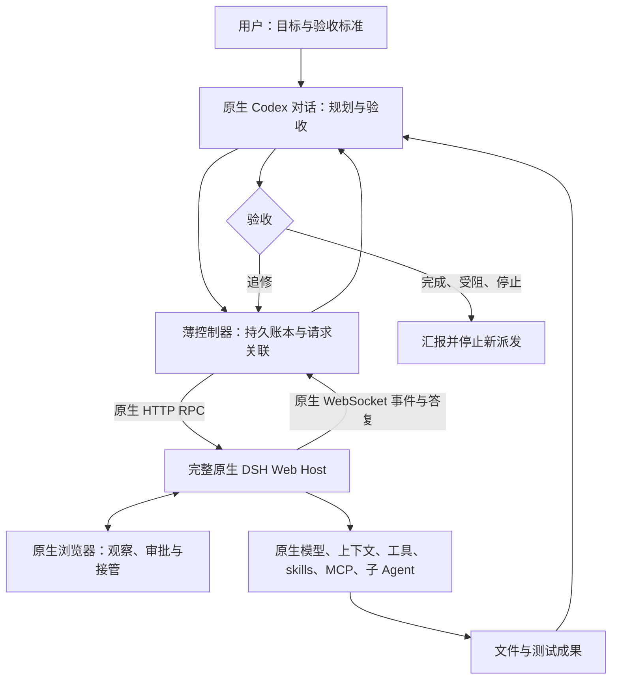

# 实现流程与技术细节

控制器负责通信和请求状态，当前 Codex 对话负责决策，原生 DSH 负责实际模型执行。三者保留各自职责。

## 安装与本机配置

0.1.1提供setup入口，从当前安装位置自动确定toolRoot，将通用Skill原样复制到个人Codex目录，并生成独立local-settings.json。公开仓库与个人SKILL.md保持字节一致；只有自动生成的配置含本机绝对路径，凭证保存在私有StateStore。setup不启动模型轮次或重建DSH配置。

CLI状态目录按显式参数、个人配置、旧版cwd/.codex-dsh依次选择。配置存在但无效时报错，不能悄悄换新目录。connections只列允许的元数据，不输出cookie/提示正文；存在记录不是在线鉴权证明。真正发送仍由原生Host验证cookie。个人配置被搬到另一台电脑时需重新setup，不携带旧凭证作为通用安装资产。

独立可编辑源见 [architecture.mmd](architecture.mmd)。

## 传输和执行

src/native.mjs 负责令牌交换、原生 HTTP /api/... RPC 和 /api/remote.mux WebSocket。只允许 HTTPS 或本机 HTTP，拒绝 URL 用户名密码；凭证保存在私有状态目录。令牌交换不跨站跟随跳转。

session/create 创建原生会话，session/prompt 投递消息，session/follow 获取快照及后续事件。CLI 不直接请求 DeepSeek 提供方，不改变模型、压缩、工具注册或输出长度参数，没有另一个推理模型。

## 关联和恢复

src/events.mjs 按本地 requestId、原生 user/message.source.rpcId 和 turn 关联结果，不能用其他请求的 turn/end 判定完成。完整历史分页检测缺口、冲突；答复不静默截断。

src/store.mjs 使用私有目录、原子替换和互斥锁。发送前持久化意图；无法确定对端是否接收时保留 SUBMISSION_UNKNOWN。恢复读取原生历史，禁止自动重发不明请求。

冷快照可能含原生合成 interrupted 尾，不能当作持久终态证明。重连按完整快照协调。resume 是控制器观察恢复，不重放 prompt，也不保证 Host 所有后台任务恢复。

0.1.2对原生header的ID与cwd做本地realpath、目录类型及可用dev/ino核验；新建保存目录身份，旧账本首次恢复建立当前身份，事务内防止并发旧快照覆盖已建立身份。最后投递前在派发锁内再核验并检查停止标记。它不是原子文件系统/Host锁，不能重建升级前的目录历史，也不限制原生工具对其他获准execution root写入；Git基线/允许清单另核。

tasks按同Host账本与原生session列表联结，标题只取实际projection，不从basename猜标题；recover唯一匹配才恢复原task，无匹配/歧义均不创建或重投。列表会更新本地观察账本，不发模型提示；active为运行或未决请求线索，不代表用户目标是否完成。

错误通过固定diagnostic字段允许清单输出，不透传原生message/details。只有已核对的RPC派发前拒绝及HTTP鉴权拒绝可标knownRejected；内部、领域未知、取消错误及所有远程stream错误均保守未知，避免副作用后重试。更好的诊断不等于原生取消或Node断言已经修复，当前多轮停止差异见C13。

## 工作区、合同与执行证据

src/workspace.mjs 通过原生 workspace/follow 读取基线、workspace/create 注册并读回目录身份；start --workspace 向原生 session/create 传 workspaceId，随后核 cwd 与成员关系。旧 session 仅附加，不迁移或改头。

src/contract.mjs 保存 dsh-contract/v1 资产，将 task/session/nativeCwd 与独立 executionRoot 的 Git/文件基线绑定。修订显式保留要求；删除/替换 requirement 须逐项决定。send --contract-sha 首次附完整合同，后续确认同 hash 后只附引用及增量；上下文不明时重读资产。合同不替代原生权限或用户费用授权。

src/execution.mjs 以 shell:false 运行计划，持久化执行意图、原始字节证据和 dsh-run/v1 回执；未决意图禁止重跑。文本白名单仅在内容指纹上等价 CRLF/LF，原始日志/资产仍字节严格。receipt 重核当前源、可执行文件、完整显式 runtimeInputs 和执行器指纹；省略 runtimeInputs 不可复用。repo-full 要求有效 readiness 及所有定向证据，退出 0/自报通过不足以验收。详见[合同与证据手册](manuals/contracts.md)。本地执行无 OS 沙箱、后代进程围栏或事务合入保证。

## 增量投影与用量

src/view.mjs 生成默认最新请求的 summary，generation 覆盖 cursor 外的停止/审批/错误变化；结果引用保留 hash/字节数，完整答复仍在私有资产。listen 输出 JSONL，单 watcher 持有有效审批 lease，最长 60 秒，退出输出 leaseOpen=false；另一 CLI 提交审批。监听程序不是永久模型主控。

src/usage.mjs 输出 dsh-usage/v1，保留单一原生 session 内任务请求关联、末次采样、缺失与冲突；不输出消息正文。不明计数不补零，总输入为非缓存+缓存读+缓存写，缓存读比例以总输入为分母。它不提供 Codex 端用量或双方总费用/节省结论。

## 审批和停止

审批使用原生 $events waterfall，并由同一活跃客户端回应。其他会话或未归属事件继续传递。观察进程退出后旧审批不能复用；原生 UI 保留。部署自身若绕过审批，控制器不能凭空恢复它。

停止先阻止新 send、run 与审批决定，再处理自有队列和允许范围内的原生取消。共享会话无法按请求原子取消，保守返回 STOP_PENDING；不归档、不删除提醒、不杀共享 Host。无法证明后台任务、子树或未知提交已静止，也保留 pending。STOPPED 仅限报告列明的会话观察范围。

0.1.3把观察到的foreign rpc、未知真实user消息、foreign/未知队列持久化为sharedStopRequired；五类原生context来源不算真实输入。stop在取消前重新核可观察历史与队列；一旦共享，不因队列暂时清空恢复专属取消，仅移除本任务项并记录cancelSkippedReason。这个保守门不提供Host侧的conditional-cancel或跨客户端原子锁。

0.1.2持久化最近一次stopAttempt及白名单stopDiagnostic，分别记录观察就绪、队列、取消、协调阶段；accepted与终态分开。前快照不新增session/list依赖，running未知填null；后快照读取原生列表。回执不记录原生错误正文、提示、凭证或提供方内容；并发时按attempt id保护最新诊断，任务摘要呈现最新尝试。诊断加载器仅用于独立本机mock进程，产品不加载或改写原生bundle。

## 运行边界

循环决策发生在活跃 Codex 对话；没有常驻调度服务。观察超时不取消任务，断线需要再次调用恢复/跟随；Codex 配额耗尽或关闭后不承诺持续自主调度。

原生工具可直接改动指定项目目录。隔离工作树、成果接收和回滚由项目合同与 Codex 决定，本工具不提供多文件事务沙箱。通信成功不直接证明官方满上下文长度、成本或缓存比例，详见 [验证说明](validation.md)。
