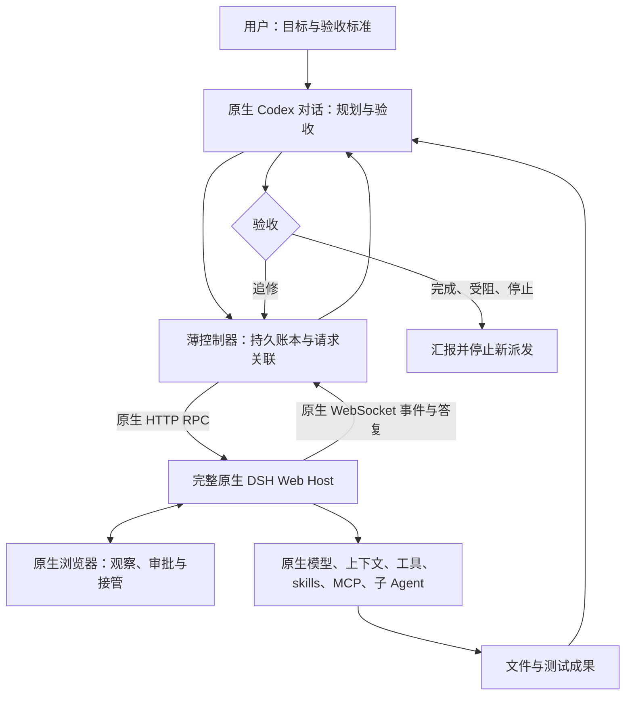

# 实现流程与技术细节

控制器负责通信和请求状态，当前 Codex 对话负责决策，原生 DSH 负责实际模型执行。三者保留各自职责。

独立可编辑源见 [architecture.mmd](architecture.mmd)。

## 传输和执行

src/native.mjs 负责令牌交换、原生 HTTP /api/... RPC 和 /api/remote.mux WebSocket。只允许 HTTPS 或本机 HTTP，拒绝 URL 用户名密码；凭证保存在私有状态目录。令牌交换不跨站跟随跳转。

session/create 创建原生会话，session/prompt 投递消息，session/follow 获取快照及后续事件。CLI 不直接请求 DeepSeek 提供方，不改变模型、压缩、工具注册或输出长度参数，没有另一个推理模型。

## 关联和恢复

src/events.mjs 按本地 requestId、原生 user/message.source.rpcId 和 turn 关联结果，不能用其他请求的 turn/end 判定完成。完整历史分页检测缺口、冲突；答复不静默截断。

src/store.mjs 使用私有目录、原子替换和互斥锁。发送前持久化意图；无法确定对端是否接收时保留 SUBMISSION_UNKNOWN。恢复读取原生历史，禁止自动重发不明请求。

冷快照可能含原生合成 interrupted 尾，不能当作持久终态证明。重连按完整快照协调。resume 是控制器观察恢复，不重放 prompt，也不保证 Host 所有后台任务恢复。

## 审批和停止

审批使用原生 $events waterfall，并由同一活跃客户端回应。其他会话或未归属事件继续传递。观察进程退出后旧审批不能复用；原生 UI 保留。部署自身若绕过审批，控制器不能凭空恢复它。

停止先阻止新派发，再处理自有队列和允许范围内的原生取消。共享会话无法按请求原子取消，保守返回 STOP_PENDING；不归档、不删除提醒、不杀共享 Host。无法证明后台任务、子树或未知提交已静止，也保留 pending。STOPPED 仅限报告列明的会话观察范围。

## 运行边界

循环决策发生在活跃 Codex 对话；没有常驻调度服务。观察超时不取消任务，断线需要再次调用恢复/跟随；Codex 配额耗尽或关闭后不承诺持续自主调度。

原生工具可直接改动指定项目目录。隔离工作树、成果接收和回滚由项目合同与 Codex 决定，本工具不提供多文件事务沙箱。通信成功不直接证明官方满上下文长度、成本或缓存比例，详见 [验证说明](validation.md)。
